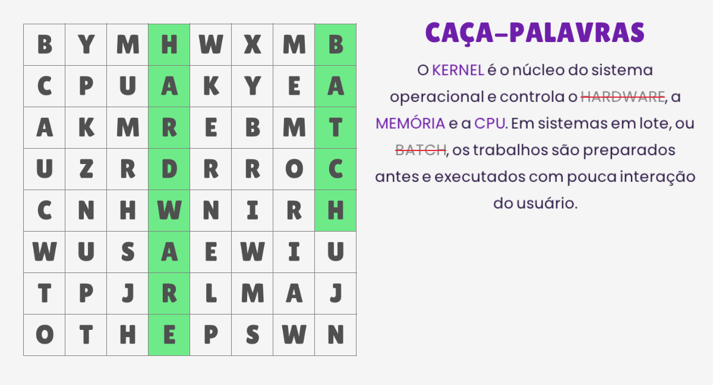
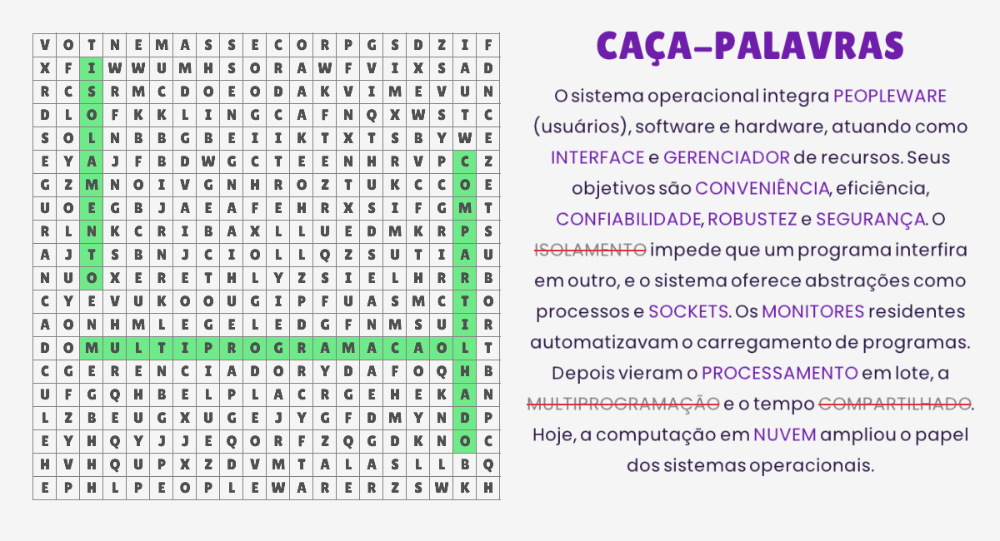
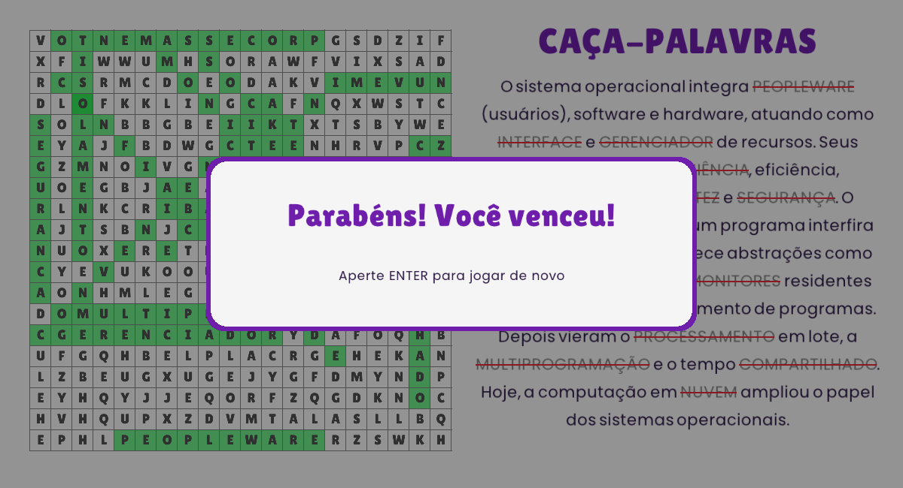

# Caça-Palavras de Sistemas Operacionais

Jogo de caça-palavras feito em **C** com a biblioteca gráfica **[raylib](https://www.raylib.com/)**.

Foi desenvolvido para uma **atividade da disciplina de Sistemas Operacionais**. As palavras escondidas e os textos de cada nível vêm do **capítulo 1 (Introdução a sistemas operacionais)** do livro da disciplina.



## Funcionalidades

- **3 níveis** com grades e dificuldades crescentes (veja a tabela abaixo).
- **Direções obrigatórias:** cada nível sempre tem pelo menos uma palavra em cada tipo de direção que ele usa. Se a grade sorteada não cumprir isso, o jogo sorteia outra.
- **Texto do nível** ao lado da grade, com as palavras do jogo destacadas em roxo. Quando uma palavra é encontrada, ela fica **cinza e riscada** no texto.
- **Seleção com o mouse:** clique na primeira letra, arraste até a última e solte. Vale nos dois sentidos.
- **Passagem automática de nível** ao encontrar todas as palavras e mensagem de vitória no final.
- **Letras com acento** e fontes próprias (Lilita One e Poppins).
- **Tecla G:** mostra ou esconde o gabarito (modo de teste).

| Nível | Grade | Palavras | Direções |
|:-----:|:-----:|:--------:|----------|
| 1 | 8 × 8 | 5 | horizontal e vertical |
| 2 | 16 × 16 | 10 | horizontal, vertical e diagonal |
| 3 | 20 × 20 | 14 | horizontal, vertical, diagonal e invertida (de trás pra frente) |



## Como jogar

1. Leia o texto: as palavras em **roxo** estão escondidas na grade.
2. Clique na primeira letra de uma palavra, **arraste** até a última e solte. Pode ser do começo ao fim ou do fim ao começo.
3. Ao achar todas as palavras, o próximo nível começa sozinho.
4. No nível 3, depois da vitória, **ENTER** recomeça o jogo.
5. **G** mostra ou esconde o gabarito.



## Requisitos

- Compilador C (GCC) e `make`
- Biblioteca **raylib** (5.0 ou mais nova)
- A pasta `fonts/` precisa ficar **ao lado do executável**

## Instalação e execução no Windows

1. Baixe e instale o **instalador oficial da raylib para Windows** em <https://www.raylib.com/> (seção *Download*). Ele instala a raylib e um compilador (w64devkit) em `C:\raylib`.
2. Baixe este projeto (`git clone` ou ZIP) e entre na pasta dele.
3. Compile. No VS Code, abra a pasta e use **Ctrl+Shift+B**. Ou, pelo terminal, na pasta do projeto:

```
   C:\raylib\w64devkit\bin\mingw32-make.exe RAYLIB_PATH=C:/raylib/raylib PROJECT_NAME=main "OBJS=src/*.c"
```

4. Execute o `main.exe` gerado, com a pasta `fonts/` ao lado dele.

## Instalação e execução no Linux

Testado no **Ubuntu 24.04** com a **raylib 5.5**. Para outras distribuições, veja as dependências na [wiki da raylib](https://github.com/raysan5/raylib/wiki/Working-on-GNU-Linux).

### Opção A: instalando a raylib no sistema (precisa de `sudo`)

```bash
sudo apt install build-essential git libasound2-dev libx11-dev libxrandr-dev libxi-dev \
     libgl1-mesa-dev libglu1-mesa-dev libxcursor-dev libxinerama-dev libwayland-dev libxkbcommon-dev

git clone --depth 1 --branch 5.5 https://github.com/raysan5/raylib.git
cd raylib/src
make PLATFORM=PLATFORM_DESKTOP
sudo make install
```

Depois, volte para a pasta do projeto e compile:

```bash
gcc src/*.c -o cacapalavras -std=c99 -Wall -lraylib -lGL -lm -lpthread -ldl -lrt -lX11
./cacapalavras
```

### Opção B: sem `sudo` (pacote pré-compilado)

Ainda é preciso ter o `gcc` e os pacotes de desenvolvimento do X11 e do OpenGL (`libx11-dev`, `libgl1-mesa-dev`).

```bash
curl -L -o raylib.tar.gz https://github.com/raysan5/raylib/releases/download/5.5/raylib-5.5_linux_amd64.tar.gz
tar xzf raylib.tar.gz

gcc src/*.c -o cacapalavras -std=c99 -Wall \
    -Iraylib-5.5_linux_amd64/include raylib-5.5_linux_amd64/lib/libraylib.a \
    -lGL -lm -lpthread -ldl -lrt -lX11
./cacapalavras
```

## Estrutura do projeto

```
src/
├── main.c        abre a janela e repete: atualizar o jogo, desenhar
├── config.h      tamanhos da janela, da grade e da coluna do texto
├── niveis.c/.h   os 3 níveis: palavras, direções e textos
├── jogo.c/.h     regras: montar a grade, mouse, achar palavras, passar de nível
└── interface.c/.h  tudo que é desenhado: fontes, cores, grade, texto, título
fonts/            LilitaOne-Regular.ttf e Poppins-Regular.ttf
docs/             capturas de tela
```

## Como funciona (resumo)

- **Montar a grade:** para cada palavra (das maiores para as menores), o jogo sorteia uma posição e uma direção e confere se ela cabe sem sair da grade nem bater em outra letra. As casas que sobram são preenchidas com letras aleatórias. Se alguma palavra não couber, ou se faltar uma direção obrigatória, a grade é sorteada de novo.
- **Direções:** uma tabela guarda quanto andar na linha e na coluna a cada letra. As três primeiras (direita, baixo e diagonal) são obrigatórias, e no nível 3 também precisa haver pelo menos uma palavra invertida.
- **Texto do nível:** as palavras do jogo ficam entre asteriscos, como `*KERNEL*`. Quando a palavra tem acento, escreve-se `*MEMORIA|MEMÓRIA*` (a parte antes da barra é a palavra da grade, e a depois é o que aparece na tela).
- **Seleção:** ao soltar o mouse, o jogo compara o início e o fim do arrasto com o início e o fim de cada palavra escondida, nos dois sentidos.

## Alterando os níveis

Palavras, tamanho da grade, direções e textos estão em `src/niveis.c`. Se mudar uma palavra da lista, mude também o que vem **antes da barra** no texto do nível, senão ela não será riscada. Tamanhos e posições da janela ficam em `src/config.h`, e o tamanho da letra do texto de cada nível em `src/interface.c`.

## Limitações conhecidas

- As palavras na grade não têm acento (`MEMORIA`, `ABSTRACAO`), embora o texto tenha.
- O jogo usa só o mouse (e as teclas G e ENTER).
- A janela tem tamanho fixo (1200 × 650), então a tela precisa ser maior que isso.

## Créditos

- **[raylib](https://www.raylib.com/)**, de Ramon Santamaria (@raysan5), licença zlib.
- Fontes **Lilita One** e **Poppins**, do Google Fonts, licença SIL Open Font License.
- Projeto-base de VS Code: *Raylib-CPP Starter Template for VS Code* (<https://youtu.be/acvgbKRaxDI>).
- Desenvolvido por **Ester** com o auxílio do **Claude** (IA da Anthropic), que ajudou a escrever, revisar e explicar partes do código.